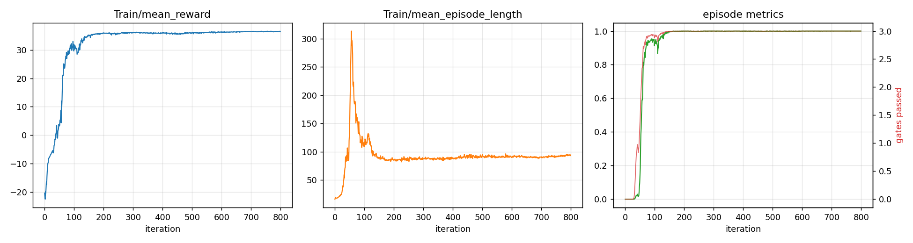
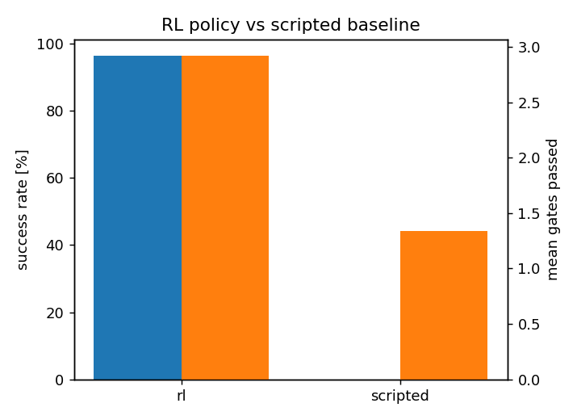

# 无人机仿真实操：在 Isaac Lab 里训一个"穿门竞速"策略

> 面向：做无人机、但没系统用过 Isaac Sim / Isaac Lab / MuJoCo / Gazebo 的人。
> 目标：用一次完整、能跑通、能被面试官追问的实操，把"仿真平台经验"补上。
>
> **本次不算 tutorial 的搬运**：环境是我在官方 Quadcopter 任务基础上改的（新增赛道、门穿越判定、
> 势能式进度奖励、漏门终止），训练、评测、对照组、可视化全部实跑，踩坑记录见 [docs/03](docs/03-task-design.md)。

---

## 1. 你会得到什么

| 产出 | 位置 |
|---|---|
| 一个自定义 Isaac Lab 任务（Direct 工作流，gym 注册，可在 CLI 训练） | [labs/drone_racing/](labs/drone_racing/) |
| 手写几何控制器（PX4 式级联环，作为 RL 对照组） | [labs/scripted_controller.py](labs/scripted_controller.py) |
| 训练好的 PPO 策略 + 训练曲线 + 成功率评测 | [docs/04-results.md](docs/04-results.md) |
| 五篇知识文档（概念 / 代码解剖 / 任务设计 / 结果 / 平台对照） | [docs/](docs/) |
| 可复现的远端运行脚本 | [remote/](remote/) [scripts/](scripts/) |
| 训练曲线、轨迹图、演示视频 | [figures/](figures/) |

### 结果速览（实跑数据）

| 指标 | PPO 策略 | 手写几何控制器 |
|---|---|---|
| 成功率（3 门全过） | **96.6%** | 0% |
| 平均过门数 | **2.92 / 3** | 1.34 / 3 |
| 平均完赛时间 | 38 步（0.76 s） | 超时（190 步未完成） |

训练规模：4096 并行环境 × 800 轮 = **1.05 亿步，13 分 50 秒**（≈126k env-steps/s）。




演示视频：[figures/drone_racing_demo.mp4](figures/drone_racing_demo.mp4)

---

## 2. 环境

| 项 | 值 |
|---|---|
| Isaac Sim | 5.1.0 |
| Isaac Lab | 2.7.0（editable 源码安装） |
| GPU | RTX 4090 24 GB（云端） |
| Python | 3.11.13（`C:\IsaacLab\_isaac_sim\python.bat`） |
| 资产 | 离线镜像在 `C:\isaac_assets`（国内直连 AWS S3 会失败） |

> 本次所有计算都在**云端 GPU**上跑，本地只存代码和图。
> Isaac Lab 在 Windows 上的启动/托管有一堆坑（僵尸 GPU 上下文、SSH 断连杀进程树、
> `.bat` 编码问题），本仓库踩过的都在[第 5 节](#5-windows--isaac-lab-的-5-条硬规则血泪版)汇总。

---

## 3. 学习路线（按顺序做，每步都有明确的"通过标准"）

### Lab 0 · 概念（30 分钟，不必动手）

读 [docs/01-concepts.md](docs/01-concepts.md)。**这 10 分钟比跑代码更重要**，因为面试问的是概念不是命令。
重点记住：

- 物理步长 vs 控制步长（`decimation`）
- 三个平台不是竞品，是不同层次
- 动作空间的三档设计，以及为什么无人机 RL 常用"推力 + 三轴力矩"
- 域随机化解决什么、不解决什么

### Lab 1 · 冒烟测试：确认链路是通的（5 分钟）

```powershell
# 本地: 把脚本推上去
scp labs/lab1_smoke.py gpu:C:/work/drone_lab/
scp remote/lab1.bat    gpu:C:/temp/

# 远端: 启动 (会等 GPU 显存回落, 用计划任务托管, SSH 断开不杀)
ssh gpu "cmd /c powershell -NoProfile -ExecutionPolicy Bypass -File C:\temp\run_job.ps1 -Name lab1 -BatPath C:\temp\lab1.bat"

# 看日志
ssh gpu "cmd /c type C:\temp\jobs\lab1.log"
```

**通过标准**（实测输出）：

```
[LAB1] robot mass (kg) : 0.0282
[LAB1] robot weight (N): 0.2766
[LAB1] hover throttle  : 0.0526
[LAB1] 200 steps in 3.76s -> 3401 env-steps/s
```

三个数字就是三个知识点：

1. **28.2 g** —— 资产加载成功，且和真实 Crazyflie（~27 g）一致；
2. **0.2766 N** —— 重力算对了；
3. **0.0526** —— 悬停油门，`2/1.9 − 1`。**这是验证"执行器模型配对了没有"的最快办法。**

> 以后接手任何一台新 GPU 服务器，第一件事都是跑这个。它把"GPU 坏了"和"资产缺了"分开。

### Lab 2 · 读懂环境：别人的代码怎么改成你的（40 分钟）

读 [docs/02-isaaclab-anatomy.md](docs/02-isaaclab-anatomy.md)，对照
[reference/quadcopter/quadcopter_env.py](reference/quadcopter/quadcopter_env.py)（官方四旋翼任务，253 行）。

按文档里的 **7 个问题**顺序读：时间尺度 → 动作 → 观测 → 奖励 → 终止 → 复位 → 并行。

**通过标准**：能不看代码回答——

- 把 `decimation` 从 2 改成 4 会发生什么？
- 为什么观测用"投影重力"而不是欧拉角？
- 4096 个环境为什么不吃爆显存？

### Lab 3 · 写自己的任务：门穿越（2 小时，含踩坑）

读 [docs/03-task-design.md](docs/03-task-design.md)，然后跑通：

```powershell
scp -r labs/drone_racing gpu:C:/IsaacLab/source/isaaclab_tasks/isaaclab_tasks/direct/
scp labs/lab3_racing_smoke.py labs/scripted_controller.py gpu:C:/work/drone_lab/
ssh gpu "cmd /c powershell -NoProfile -ExecutionPolicy Bypass -File C:\temp\run_job.ps1 -Name lab3 -BatPath C:\temp\lab3.bat"
```

**这一步的关键是"先用手写控制器验证环境"**：如果人写的几何控制器都穿不过门，
问题一定在环境/物理/坐标系，不在 RL。文档里记录了三个真实踩过的坑（世界坐标 vs 局部坐标、
`R` 与 `R^T`、事件检测放哪个钩子），**每一个都是 30 分钟级别的迷惑**。

**通过标准**：`gates_passed per env` 不再全是 0，且有 `success_rate = 1.0` 出现过。

### Lab 4 · 训练与评测（30 分钟）

```powershell
scp remote/train3.bat gpu:C:/temp/
ssh gpu "cmd /c powershell -NoProfile -ExecutionPolicy Bypass -File C:\temp\run_job.ps1 -Name train3 -BatPath C:\temp\train3.bat"
```

4096 个并行环境，800 轮 ≈ 14 分钟（300 轮到 60% 成功率，800 轮到 100%）。然后评测：

```powershell
scp labs/eval_racing.py labs/make_plots.py gpu:C:/work/drone_lab/
```

**通过标准**：成功率随训练上升，且能解释 TensorBoard 里每条曲线为什么长那样。

结果与分析见 [docs/04-results.md](docs/04-results.md)。

---

## 4. 目录结构

```
drone-sim-lab/
├── labs/
│   ├── lab1_smoke.py            # Lab1: 冒烟测试
│   ├── lab3_racing_smoke.py     # Lab3: 自定义任务 + 手写控制器
│   ├── lab3_debug.py            # 调试用: 打印终止判据分解
│   ├── scripted_controller.py   # 几何控制器 (RL 对照组)
│   ├── eval_racing.py           # 成功率评测 + 轨迹导出
│   ├── make_plots.py            # 训练曲线/轨迹/对比图
│   └── drone_racing/            # ★ 自定义 Isaac Lab 任务包
│       ├── __init__.py          #   gym.register("Isaac-DroneRacing-Direct-v0")
│       ├── drone_racing_env.py  #   DroneRacingEnvCfg + DroneRacingEnv
│       └── agents/rsl_rl_ppo_cfg.py
├── remote/                      # 远端 .bat 启动器 (必须纯 ASCII!)
├── scripts/                     # 本地 SSH 辅助 (run_and_wait / wait_log)
├── reference/                   # 官方源码, 供对照阅读
├── docs/                        # 五篇知识文档
└── figures/                     # 结果图 + 演示视频 + 原始评测数据
```

---

## 5. Windows + Isaac Lab 的 5 条硬规则（血泪版）

1. **同一时间只跑一个 Kit 进程**。强杀后必须等显存回落到 <800 MiB 再启动，
   否则新实例会被僵尸 GPU 上下文卡死（现象是 `step()` 永远不返回）。
2. **长任务必须用计划任务托管**。Windows OpenSSH 会话结束会杀掉整棵子进程树。
3. **`.bat` 文件必须纯 ASCII**。中文注释被 cmd 按 GBK 解码时可能吃掉下一行——
   本次就因此让 `cd` 命令消失，脚本在 `system32` 下找不到文件。
4. **`.bat` 最后一行必须有换行符**，否则 cmd 会丢弃最后一条命令（`echo EXITCODE` 就这么丢的）。
5. **不要用 `ssh gpu "cmd /c ...(...)..."`**，括号会被 cmd 当成代码块。复杂逻辑写进 `.bat` 再执行。

---

## 6. 这套东西在面试里怎么讲

一句话版本：

> "我在 Isaac Lab 里基于官方 Quadcopter 任务实现了一个无人机穿门竞速环境：
> 自定义了 3 门顺序赛道、门平面穿越判定和势能式进度奖励，用 PPO 在 4096 个并行环境上训练，
> 800 轮 / 1.05 亿步 / 14 分钟后成功率 96.6%（手写级联控制器对照组是 0%）。
> 我踩过 Isaac Lab 的 Direct 工作流里事件检测钩子顺序的问题，也处理过资产离线镜像；
> 更关键的是我先用稠密距离奖励训出 59%，继续训练时策略学会了在门前悬停骗奖励，
> 改成势函数差分后才稳定收敛到 100%——这让我对 reward shaping 的陷阱有了直观认识。"

细节弹药在 [docs/05-platforms.md](docs/05-platforms.md) 的"面试高频问法"表里。

---

## 7. 下一步

按性价比排序（详见 docs/03 第 7 节）：

1. **域随机化**：随机化推重比/质量/动作延迟，画鲁棒性曲线（2 小时，最像工程）
2. **MuJoCo 重建同一赛道**：体会物理引擎差异（3 小时）
3. **PX4 SITL + offboard**：补齐行业链路（1 天）
4. **视觉端到端**：用 Isaac Sim 的渲染能力（1–2 天）

---

## 8. 许可与致谢

- 本项目自身代码（`labs/`、`remote/`、`scripts/`、`docs/`）采用 [MIT License](LICENSE)。
- `reference/` 下是 Isaac Lab 2.7 的原始文件副本（BSD-3-Clause，版权归 The Isaac Lab Project Developers），
  仅用于离线对照阅读，说明见 [reference/README.md](reference/README.md)。
- 感谢 NVIDIA Isaac Lab / Isaac Sim 团队，以及 ETH Zurich 的 rsl_rl。