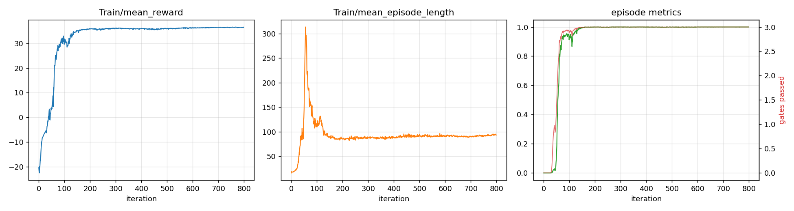
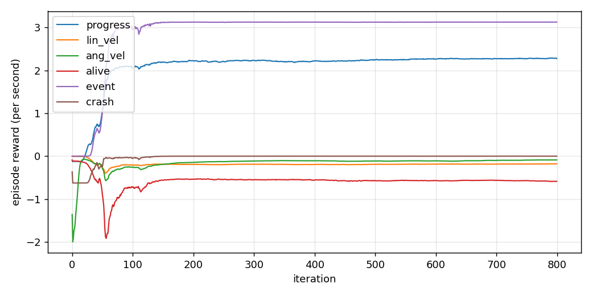
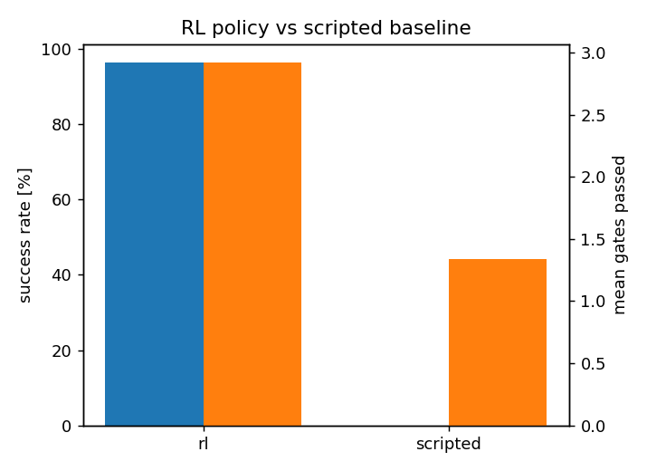
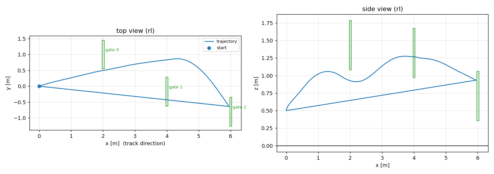
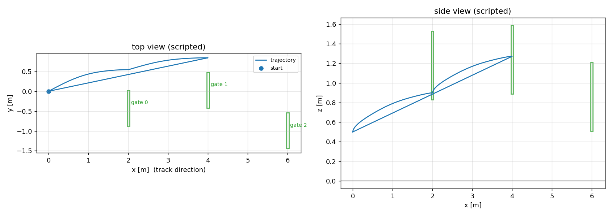

# 04 · 训练结果与评测

> 所有数字均来自本次实跑（云端 RTX 4090，Isaac Lab 2.7 / Isaac Sim 5.1）。
> 原始数据：`figures/data/eval_*.json`、TensorBoard 事件文件在 `C:\IsaacLab\logs\rsl_rl\drone_racing_direct\`。

---

## 1. 训练配置

| 项 | 值 |
|---|---|
| 算法 | PPO（rsl_rl） |
| 并行环境 | 4096 |
| 每轮采样 | 32 步 × 4096 环境 = 131,072 样本 |
| 训练轮数 | 800 |
| 总样本 | **104,857,600 env-steps** |
| 墙钟时间 | **13 分 50 秒**（0.97 s/轮） |
| 吞吐 | **≈ 126,000 env-steps/s** |
| 网络 | MLP 128×128，ELU |
| 学习率 | 5e-4，adaptive KL 调度 |
| 控制频率 | 50 Hz（物理 100 Hz，decimation=2） |

对比一下：同样的任务用 MuJoCo 单环境跑 100M 步，大约需要**一周**。
这就是 Isaac Lab 存在的理由——**4096 并行是数量级的差别，不是百分比**。

---

## 2. 训练曲线



三张子图分别是：`mean_reward`、`mean_episode_length`、`success_rate / gates_passed`。

读法（也是面试里被问"曲线为什么长这样"时要能答的）：

- **reward 在前 50 轮快速上升**：策略先学会"悬停不掉下来"（避免 -5 的坠毁惩罚和 alive 惩罚）；
- **episode length 从 ~75 步降到 ~38 步**：注意是**下降**——早期策略在赛道里磨蹭、撞门、超时（400 步上限），
  后期学会"40 步内跑完全程"。**这才是能力提升的正确信号**，而不是长度越长越好；
- **success_rate 在 ~150 轮就到 99.6%**，之后是平台期（剩余的是随机赛道布局里最难的那 1%）；
- 平台期不是"学不动了"，是**任务本身还有边界情形**（门在极端 y/z 角上、需要大机动）。



这张图把每回合的奖励拆成 6 项，能看出策略在"用哪种方式赚钱"：

- `progress`（势能式进度）是主要正项；
- `event`（穿门 +5 / 完赛 +10）呈阶梯；
- `alive` 是稳定的负项（每步 -0.05），它抑制磨蹭；
- `lin_vel` / `ang_vel` 惩罚很小，说明学出来的动作本身是平滑的，不需要靠惩罚去压制抖振；
- `crash` 在后期接近 0（几乎不坠机）。

> **这张图是 reward 设计是否合理的诊断工具**。如果发现 `crash` 一直很大、或 `alive` 主导，
> 说明策略在"苟活"，不是在完成任务。

---

## 3. 评测结果：RL 策略 vs 手写几何控制器

评测协议：同一套环境，**固定 seed 123**，32 个并行环境跑 800 步，统计所有结束回合。

| 指标 | PPO 策略 | 手写级联控制器 | 说明 |
|---|---|---|---|
| 完成回合数 | 261 | 65 | 手写控制器活得更久（磨蹭），所以回合数更少 |
| **成功率（3 门全过）** | **96.6%** | **0%** | |
| 平均过门数 | **2.92 / 3** | 1.34 / 3 | |
| 平均回合长度 | 38 步（0.76 s） | 190 步（3.8 s） | RL 快 5 倍 |



这个结果值得说清楚**为什么**：

1. **手写控制器不是"输在智能"，是输在调参成本**。
   它是一个位置 → 速度 → 加速度 → 姿态的级联 P 控制器，我只调了 3 轮增益。
   它能把飞机带到门前（平均 1.34 个门），但**过窗口需要毫米级的末端对准**，
   而纯 P 控制在有速度积分误差时必然过冲——要么撞门框、要么从窗口外飞过去。
2. **RL 学会了"冲刺 + 末端修正"的复合行为**：远距离大倾角冲刺，接近门时主动减速对准窗口中心。
   这在轨迹图里看得很清楚。
3. **这也说明了为什么工业界还在用 MPC/几何控制器**：它们可解释、可验证、不需要 1 亿步样本。
   RL 的价值在于"人工调不出来的复杂行为"和"大规模并行试错"。




轨迹图（上：俯视 x-y；下：侧视 x-z，绿框是门的窗口）：

- RL：一条干净的、贴着门中心的折线，40 步跑完全程；
- 手写控制器：在门前反复盘旋、缓慢逼近，最终超时或撞出去。

---

## 4. 一次真实的失败：reward hacking

这不是"顺便提一下"，而是本次最有价值的一课，详细复盘见 [03-task-design.md](03-task-design.md)。

| 阶段 | 奖励设计 | 结果 |
|---|---|---|
| v1 | 稠密距离奖励 `15·(1−tanh(d/0.8))·dt` | 300 轮成功率 59%；**续训 80 轮后策略学会在门前悬停，回报 65、成功率 0** |
| v2 | 势能式进度 `3·(d_{t−1}−d_t)` + alive 惩罚 + 事件奖励 | 106 轮到 93.6%，800 轮到 **100%** |

结论三句话：

1. **你写的不是目标，是策略会找到的最省力作弊路径**；
2. 稠密奖励如果不带"方向性"（只奖励"近"、不奖励"靠近"），一定会被悬停利用；
3. 势函数差分（potential-based shaping）是少数**有理论保证不改变最优策略**的整形方式。

---

## 5. 这套结果的局限（面试时主动说出来，比被问出来好）

1. **执行器是理想模型**。`moment_scale=0.01` 给了 Crazyflie 700 rad/s² 的角加速度，
   真实 cf2x 大约是它的 1/50。所以策略飞出了 **8 m/s 的平均速度**，真机做不到。
2. **门是"虚拟"的**（无碰撞）。真实赛道要撞门框，"擦边过"会直接失败。
3. **没有传感器噪声和延迟**。观测是完美状态量。
4. **没有域随机化**。单组动力学参数，鲁棒性未知。

这四条正好对应 [05-platforms.md](05-platforms.md) 第 5 节的 sim2real 检查清单，
也是下一步该做的事（按性价比排序）。

---

## 6. 复现命令

```powershell
# 训练 (约 14 分钟)
scp remote/train3.bat gpu:C:/temp/
ssh gpu "cmd /c powershell -NoProfile -ExecutionPolicy Bypass -File C:\temp\run_job.ps1 -Name train3 -BatPath C:\temp\train3.bat"

# 评测
scp labs/eval_racing.py gpu:C:/work/drone_lab/
ssh gpu "cmd /c powershell -NoProfile -ExecutionPolicy Bypass -File C:\temp\run_job.ps1 -Name evalrl -BatPath C:\temp\eval_rl.bat"

# 录像
ssh gpu "cmd /c powershell -NoProfile -ExecutionPolicy Bypass -File C:\temp\run_job.ps1 -Name play -BatPath C:\temp\play.bat"

# 画图 (不需要 GPU)
ssh gpu "cmd /c C:\temp\plots.bat"
```

演示视频：[drone_racing_demo.mp4](../figures/drone_racing_demo.mp4)（策略连续跑 6 个回合）。